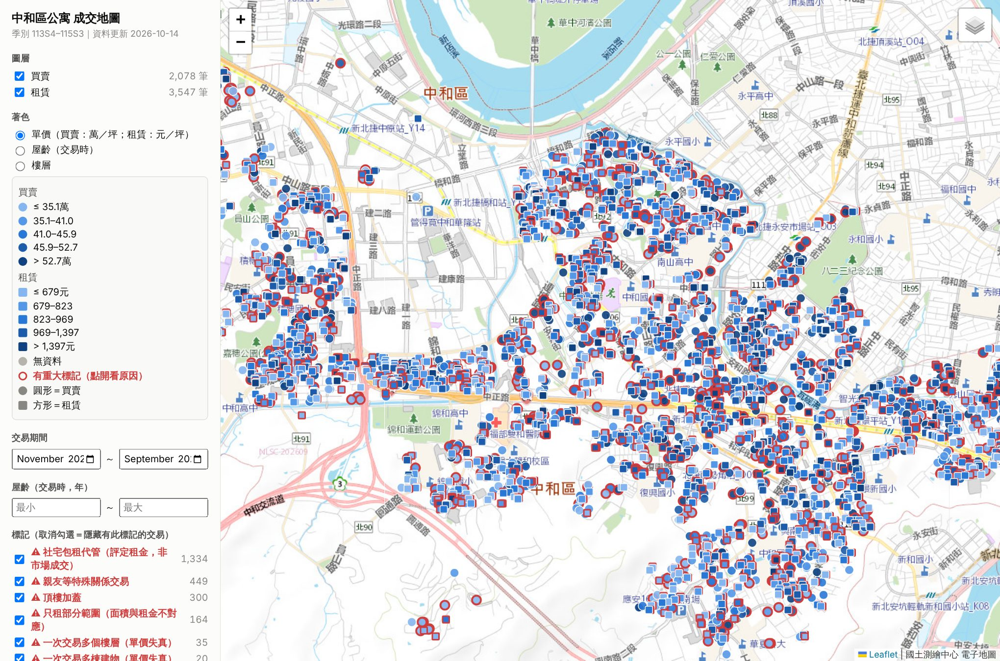
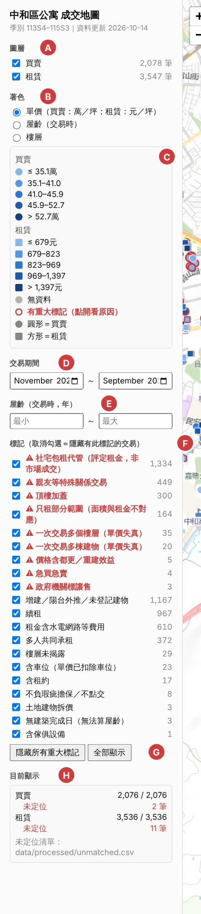
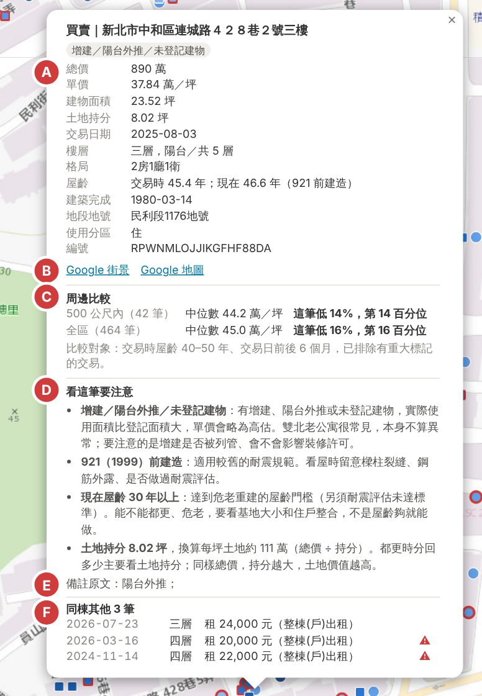
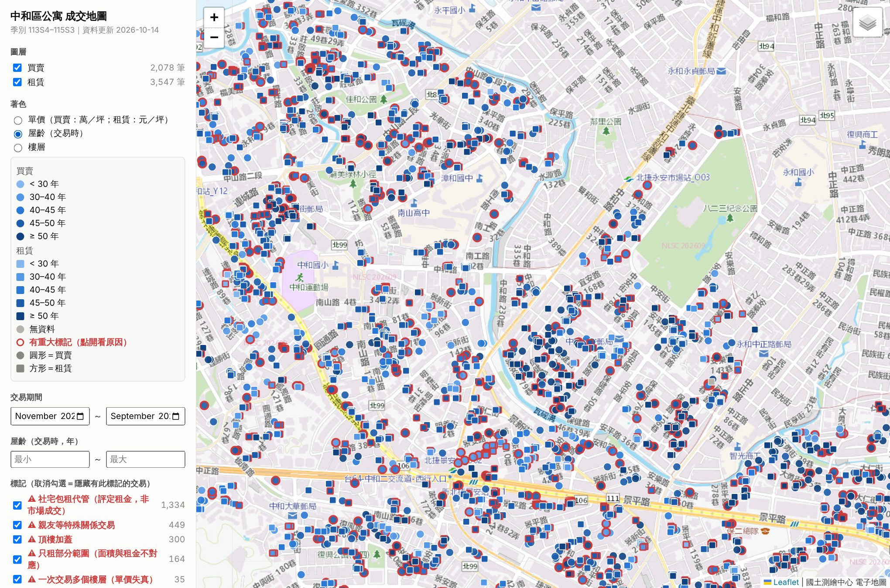
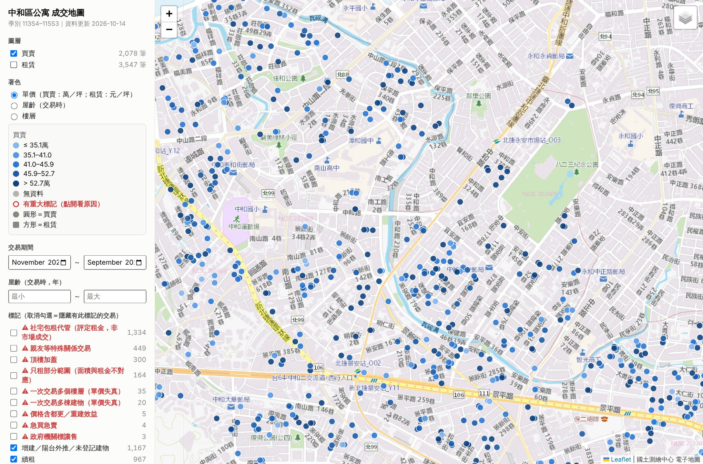

# 中和公寓成交地圖（tw-re-dev-tool）

**打開網頁：https://evantilu.github.io/tw-re-dev-tool-demo-repo/**

把政府公開的**實價登錄**整理成一張地圖，用來快速判斷一個老公寓物件的價格合不合理。打開地圖可以看到：

- **中和區每一筆公寓成交**：最近 8 季（113 年第 4 季到 115 年第 3 季），買賣約 2,100 筆、租賃約 3,500 筆，每一筆都定位到門牌。
- **依單價、屋齡、樓層著色**：一眼看出哪些街廓比較貴、哪些比較舊。
- **點開任何一筆**：除了成交明細，還會和附近同條件的成交自動比較，並說明這筆有什麼要注意的地方。

**目錄**：[怎麼打開](#怎麼打開) ｜ [左側面板](#左側面板) ｜ [點開一筆成交](#點開一筆成交) ｜ [著色與篩選](#著色與篩選) ｜ [資料來源與限制](#資料來源與限制)

---

## 怎麼打開

點上面的網址就能用，電腦和手機都可以，不需要安裝任何東西，也不需要登入。底圖來自國土測繪中心，所以要連網。

地圖可以拖曳、縮放。

---

## 左側面板

- **A｜圖層**：「買賣」和「租賃」可以分開開關，右邊是筆數。
- **B｜著色**：選擇點的顏色代表什麼，有單價、交易時的屋齡、樓層三種。
- **C｜圖例**：
  - 顏色**越深越高**。單價的五個色階是把所有成交依單價分成五等分，所以每個顏色的筆數差不多。
  - **紅框**代表這筆有「重大標記」，例如親友交易、頂樓加蓋。原因要點開才看得到。
  - 圓形是買賣，方形是租賃。
- **D｜交易期間**：只看某段時間的成交。
- **E｜屋齡**：只看某個屋齡範圍，例如 40 到 50 年。
- **F｜標記**：每一種特殊情況各有一個勾選框，取消勾選就隱藏有這個標記的交易。紅字是影響大的，例如：
  - **親友等特殊關係交易**：價格通常偏低，約佔買賣的五分之一。
  - **頂樓加蓋**：加蓋面積沒登記，單價會被高估。
  - **社宅包租代管**：租金是政府評定的，不是市場成交，約佔租賃的四成。
- **G｜一鍵切換**：「隱藏所有重大標記」只留下比較乾淨的成交；「全部顯示」恢復。
- **H｜目前顯示**：現在地圖上有幾筆，以及有幾筆因為門牌對不到而無法定位。

---

## 點開一筆成交

點地圖上任何一個點，會跳出這筆的明細。

- **A｜成交明細**：總價、單價、面積、土地持分、日期、樓層、格局、屋齡、地段地號、使用分區。全部來自實價登錄。
- **B｜Google 街景、Google 地圖**：直接看建物外觀、巷弄寬度和周邊環境。
- **C｜周邊比較**：自動找出條件相近的成交，算出中位數，告訴你這筆比行情高或低多少。
  - 比較兩組：500 公尺內、全區。
  - 「條件相近」是指：交易時屋齡差 5 年以內、交易日前後 6 個月內。租賃另外限定同一種出租型態。
  - **有重大標記的交易不拿來比**，例如親友交易。
  - 「第 14 百分位」的意思是：100 筆相近的成交裡，大約只有 14 筆比這筆便宜。
  - 相近的成交少於 5 筆時，只寫「樣本不足」，不硬算。
- **D｜看這筆要注意**：
  - 這筆的每個標記代表什麼。
  - 從樓層、屋齡、土地帶出的觀察重點，例如 4 樓以上沒電梯、921 以前建造、屋齡達危老門檻、每坪土地的價格。
- **E｜備註原文**：實價登錄申報時填的備註。
- **F｜同棟其他交易**：同一個門牌的其他買賣和租賃。可以看同一棟不同樓層賣多少、租多少；有紅色 ⚠ 的是有重大標記的那幾筆。

---

## 著色與篩選

### 依屋齡著色

著色切到「屋齡」後，顏色越深越老。分界是 30、40、45、50 年：30 年是危老重建的屋齡門檻，中和的公寓大多集中在 40 到 50 年。

### 只看乾淨的買賣

做法有兩步：
1. 關掉「租賃」圖層。
2. 按「隱藏所有重大標記」。

這樣剩下的就是比較能代表市場行情的公寓買賣。拿來和手上的物件比價，比較不會被特殊交易誤導。

---

## 資料來源與限制

**資料來源**（全部是政府公開資料）

- **成交資料**：內政部實價登錄開放資料（季檔）。
- **門牌定位**：新北市門牌位置數值資料。約 99.7% 的成交對得到門牌。
- **底圖**：國土測繪中心電子地圖。

**要注意的地方**

- **地圖上只有已經成交的資料。** 正在賣、正在租的物件，以及開價和降價紀錄，要另外看 591、樂屋等平台。這個工具不能取代實地看屋和仲介給的資訊。
- **晚報案件**：實價登錄是依登記時間公布，少數交易的日期會比資料期間早很多。
- **特殊交易只標記、不刪除**：親友交易、頂樓加蓋這些都還在地圖上，用紅框標出，要不要看由你決定。
- **租金**：官方的租賃樣本偏向包租代管案件，約四成是社宅的評定租金。推估租金時建議先隱藏這類資料。
- **周邊比較是參考值**：只看屋齡、時間、距離，沒有考慮屋況、採光、臨路、格局這些現場才看得出來的條件。

